# First Pass!

:::grid{columns="4" aspect="1/2" fit="contain"}
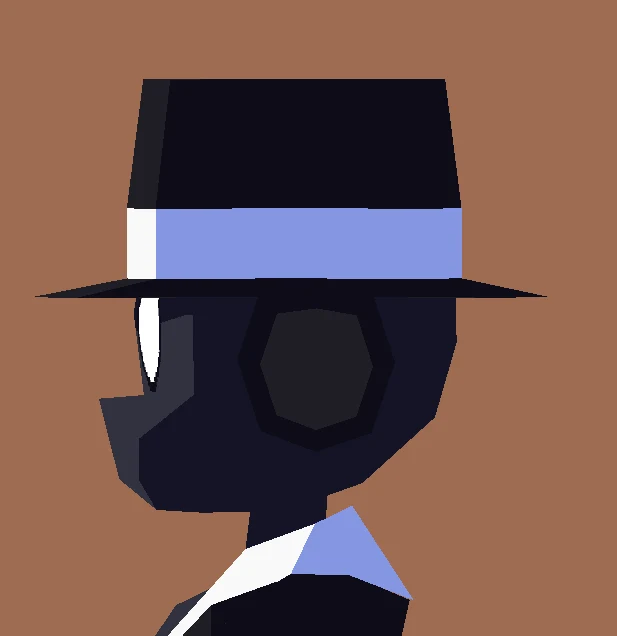

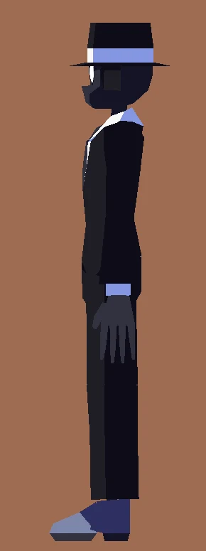

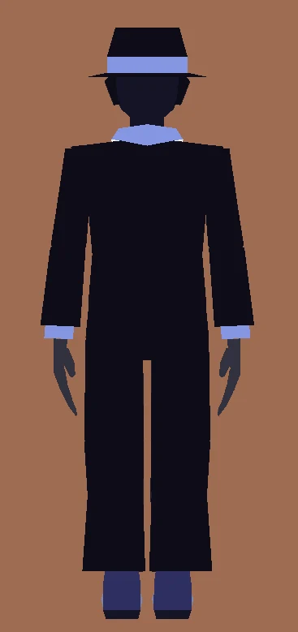

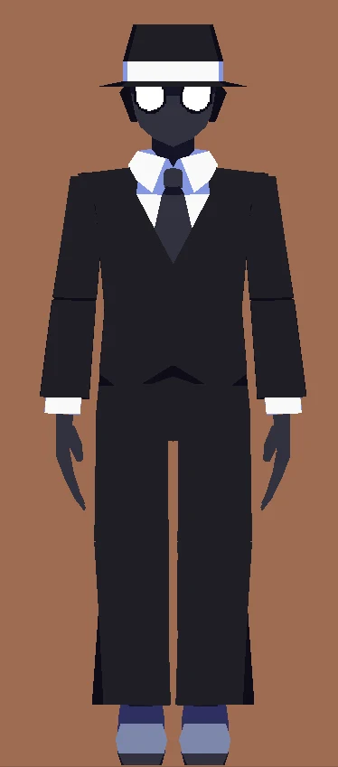
:::

# Notes to move towards final.

---

## 1. Make Secret slightly slimmer.

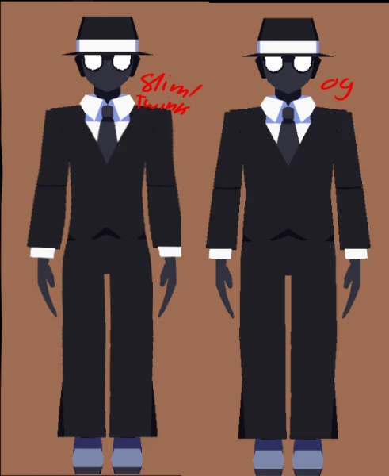

---

## 2. Experiment with hat tilt maybe?

Did a quick test in gimp, I think it looks better tilted for sure, but not sure if it would translate well in 3D space since it would clip with the headphones. Maybe experiment with it, and keep whichever works best. Feel free to DM me for critique.

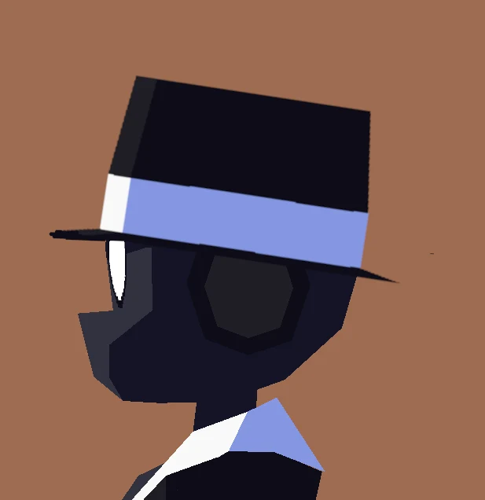

---

## 3. More fedora, less bucket hat.

Secret has always has this slight issue where his hat is kind of inconsistent across his artworks, in some art it’s kind of like a bucket hat, in others it’s more fedora like. Try to lean a bit more into the fedora, add a little divot in the hat similar to the OG art.

:::grid{columns="3" aspect="1/1" fit="contain"}
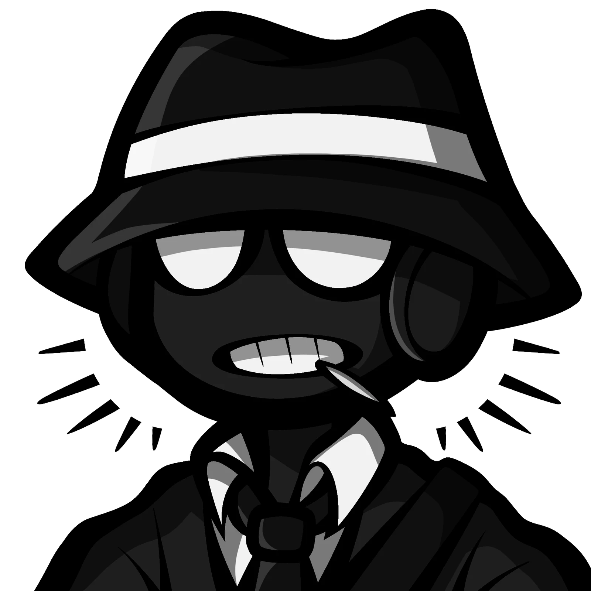

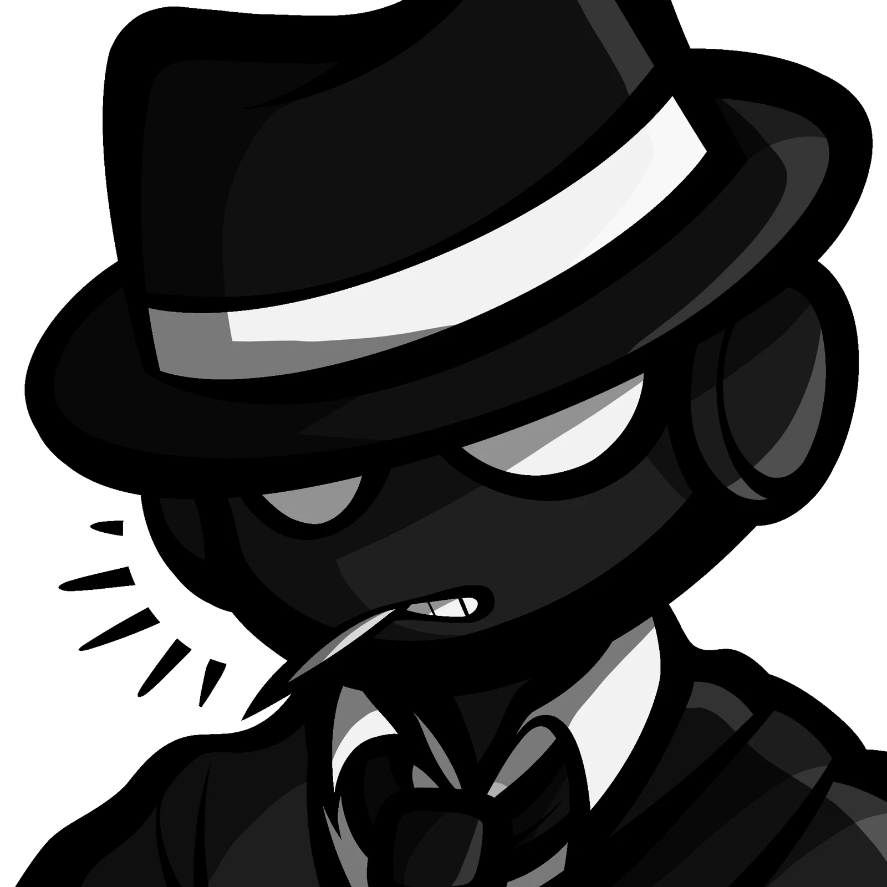

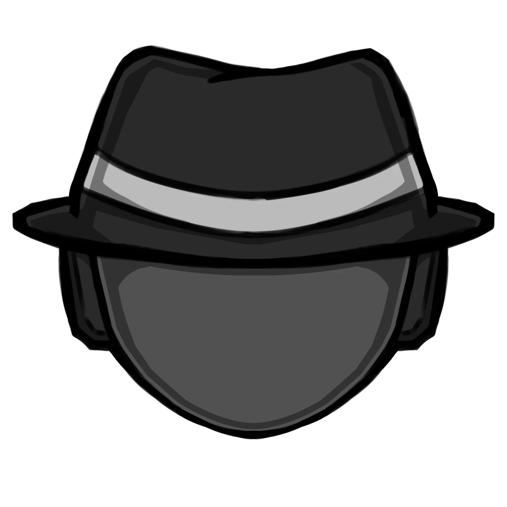
:::

---

## 4. Small things & Sister notes.

With these things, unless specified otherwise above or below, feel free to ignore or improve upon them as you see fit, these are smaller details I tend to lose track of/don’t notice but I thought the opinions would maybe be helpful.

When asked about opinion on hands & fingers.

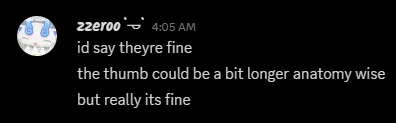

When seeing all angles initially.

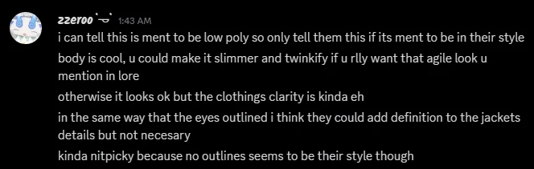

---

## 5. Accessory pass.

It gives him all his aura!

- Toothpick
- Duffel bag
- Bandage (Shown in newer arts)

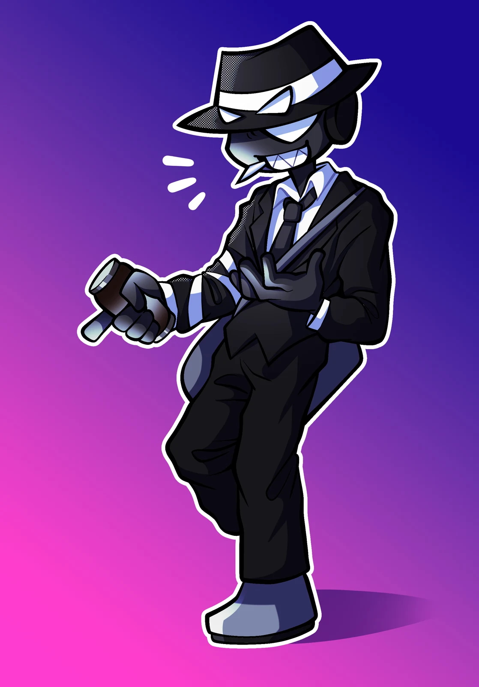

---

## 6. Unity stuff

Outline!

---

It’s looking pretty good so far, hope these notes are helpful & give you a good idea on what to work on next.
